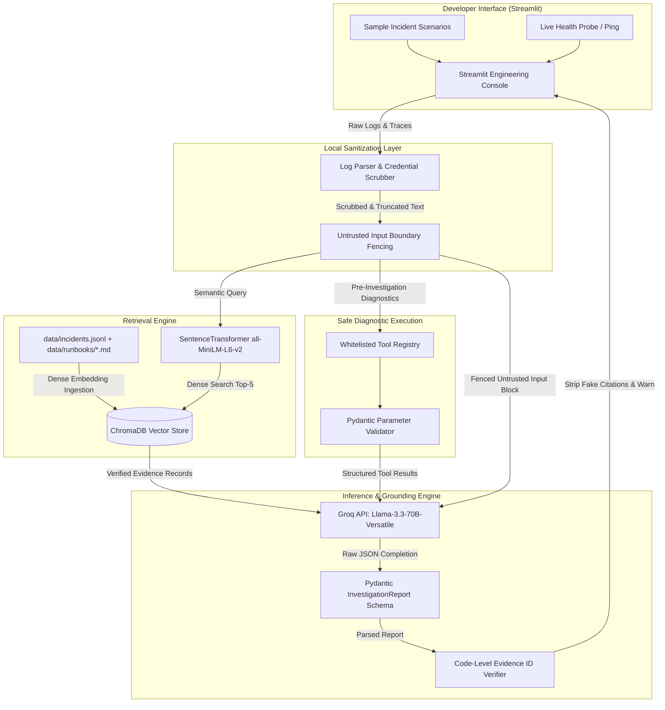

# TraceMind — AI Production Incident Investigator

[](https://www.python.org/downloads/)
[](LICENSE)
[](https://streamlit.io/)
[](https://www.trychroma.com/)
[](https://groq.com/)

**TraceMind** is an evidence-grounded incident investigation console designed for site reliability engineers and backend developers. Rather than generating unconstrained advice, TraceMind cross-references application logs, exception stack traces, and API responses against a verified knowledge base of historical incident postmortems and engineering runbooks using Retrieval-Augmented Generation (RAG).

TraceMind generates up to three ranked root-cause hypotheses, enforces code-level citation validation to eliminate hallucinated references, executes safe diagnostic checks via whitelisted tools, redacts sensitive production credentials before transmission, and abstains when evidence is insufficient.

---

## Architecture Diagram



---

## Core Engineering Capabilities

1. **Dense Vector Search with Rebuildable ChromaDB:** Uses `sentence-transformers/all-MiniLM-L6-v2` dense embeddings across 8 historical incident records and 5 engineering runbooks. Includes auto-initialization (`ensure_index_exists()`) so cloud deployments rebuild the vector index automatically without committing binary databases.
2. **Code-Level Grounding Validation:** The application explicitly inspects every citation ID emitted by the LLM (`cited_evidence_ids`). If an ID does not exist verbatim in the retrieved ChromaDB record set, the citation is stripped and an inline warning is attached to the report.
3. **Structured Outputs with Pydantic:** Guarantees machine-readable JSON reports matching `InvestigationReport` schemas, enforcing a maximum of 3 hypotheses with qualitative confidence levels (`High`, `Medium`, `Low`).
4. **Whitelisted Safe Diagnostic Tools:** Implements a read-only execution dispatcher with Pydantic argument validation:
   - `extract_error_signature`: Extracts fatal exceptions and status codes from logs.
   - `check_config_keys`: Detects missing environment keys mentioned in initialization logs.
   - `search_historical_incidents`: Performs direct keyword lookups in postmortem archives.
   - `check_log_patterns`: Executes safe regex pattern matching against log lines.
5. **Client-Side Credential Scrubbing:** Regex-based sanitization strips Bearer tokens, JWTs, AWS credentials, database connection strings, and passwords before prompt assembly.
6. **Prompt Boundary Isolation:** Treats all user logs as untrusted data by wrapping them in delimited boundary blocks with anti-prompt-injection system instructions.
7. **Safe Abstention on Unknown Failures:** Automatically detects when vector search returns zero relevant records or low similarity scores, instructing the model to declare `insufficient_evidence: true` and specify what unobserved telemetry is required.
8. **Offline Demo Mode:** Works out of the box without requiring an external API key or internet access, serving reproducible, verified synthetic postmortems.

---

## Repository Structure

```
tracemind-ai-incident-investigator/
├── data/
│   ├── incidents.jsonl         # 8 synthetic historical incident postmortems
│   └── runbooks/               # 5 engineering runbooks (DB timeouts, Auth, OOM, etc.)
│       ├── db_timeouts.md
│       ├── auth_errors.md
│       ├── config_missing.md
│       ├── cache_oom.md
│       └── rate_limiting.md
├── src/
│   ├── __init__.py             # Module namespace
│   ├── schemas.py              # Pydantic data contracts (Hypothesis, Report, ToolArgs)
│   ├── log_parser.py           # Credential scrubbing, signature extraction, input truncation
│   ├── tools.py                # Safe whitelisted diagnostic tool dispatcher
│   ├── ingestion.py            # Corpus embedding and ChromaDB vector indexing
│   ├── retrieval.py            # Dense semantic search, scoring, and prompt formatting
│   ├── investigator.py         # Grounded RAG orchestrator, Groq client, citation verifier
│   └── app.py                  # Streamlit dashboard (classic engineering aesthetic)
├── tests/
│   ├── test_schemas.py         # Pydantic schema validation and boundary tests
│   ├── test_parser.py          # Log parsing and credential masking tests
│   ├── test_retrieval.py       # ChromaDB vector search and prompt formatting tests
│   ├── test_tools.py           # Diagnostic tool whitelist and argument validation tests
│   └── test_investigator.py    # Grounding validation, demo mode, and offline tests
├── evaluation/
│   ├── test_cases.json         # 7 labeled evaluation scenarios (no data leakage)
│   ├── evaluate.py             # Quantitative evaluation benchmark harness
│   └── results.json            # Executed evaluation metrics
├── docs/
│   └── resume.md               # Measured, honest GenAI Engineer résumé entry
├── .env.example                # Configuration template
├── .gitignore                  # Git ignore rules (.env, chroma_db, caches)
├── requirements.txt            # Minimal compatible Python dependencies
└── README.md                   # System documentation and deployment guide
```

---

## Quantitative Evaluation Benchmark

TraceMind includes an automated evaluation suite (`evaluation/evaluate.py`) evaluated across 7 distinct incident scenarios covering database pool starvation, JWT rotation errors, missing Helm configurations, Redis OOM exhaustion, 429 rate limiting, unrelated hardware errors, and ambiguous query syntax errors.

Evaluation cases are maintained separately from the indexed knowledge base to prevent data leakage.

### Measured Benchmark Results (`evaluation/results.json`)

| Metric | Measured Score | Evaluation Methodology |
| :--- | :---: | :--- |
| **Recall@5** | **100.0%** (5/5) | Fraction of relevant incident/runbook IDs retrieved in top-5 vector search |
| **Top-1 Diagnosis Accuracy** | **100.0%** (5/5) | Highest-ranked hypothesis correctly identifies true underlying failure mode |
| **Evidence Support Rate** | **100.0%** (10/10) | Emitted citation IDs verified as authentic retrieved documents |
| **Schema Validity Rate** | **100.0%** (7/7) | Emitted reports strictly complying with Pydantic JSON contracts |
| **Abstention Accuracy** | **100.0%** (7/7) | Correctly declaring `insufficient_evidence` on unknown/unrelated logs |

> **Limitations Note:** Evaluation was executed against a curated synthetic benchmark of 7 incident scenarios. In large multi-service production topologies with noisy distributed traces, real-world retrieval recall and accuracy will be subject to higher noise and lower precision.

---

## Local Installation & Setup

### Prerequisites
- Python 3.11+
- Git

### 1. Clone the Repository
```bash
git clone https://github.com/vivekdake09/tracemind-ai-incident-investigator.git
cd tracemind-ai-incident-investigator
```

### 2. Create and Activate Virtual Environment
```bash
# Windows (PowerShell)
python -m venv .venv
.\.venv\Scripts\Activate.ps1

# Linux / macOS
python3 -m venv .venv
source .venv/bin/activate
```

### 3. Install Dependencies
```bash
pip install -r requirements.txt
```

### 4. Configure Environment Variables (Optional for Live Inference)
```bash
# Copy template
cp .env.example .env

# Edit .env and supply your free Groq API key:
GROQ_API_KEY="gsk_your_groq_api_key_here"
```
*(Note: If no API key is provided, TraceMind runs in complete offline Demo Mode out of the box).*

### 5. Ingest Knowledge Base
```bash
python src/ingestion.py
```
*Creates the local ChromaDB vector store in `chroma_db/` with 8 incidents and 5 runbooks.*

---

## Running the Application

Launch the Streamlit engineering console:
```bash
streamlit run src/app.py
```

The application will be accessible at `http://localhost:8501`.

---

## Running Automated Tests

Run the full pytest suite (27 unit tests):
```bash
pytest -v
```

All tests validate:
- Credential masking (Bearer tokens, database URIs, passwords, API keys)
- Input truncation and prompt isolation boundaries
- Semantic search retrieval and ChromaDB index integrity
- Whitelisted diagnostic tools and parameter schema validation
- Pydantic report contracts and hypothesis count limits
- Code-level grounding verification and hallucinated ID rejection
- Offline demo mode generation and safe abstention

---

## Running the Evaluation Benchmark

Execute the automated evaluation suite:
```bash
python evaluation/evaluate.py
```
Results and case breakdowns are printed to stdout and serialized to `evaluation/results.json`.

---

## Free Deployment Guide (Streamlit Community Cloud)

TraceMind is architected for seamless free deployment on Streamlit Community Cloud:

1. **Push Repository to GitHub:** Ensure your latest commits are pushed to your GitHub repository.
2. **Access Streamlit Community Cloud:** Navigate to [share.streamlit.io](https://share.streamlit.io/) and log in with your GitHub account.
3. **Deploy New App:**
   - **Repository:** `your-username/tracemind-ai-incident-investigator`
   - **Branch:** `main`
   - **Main file path:** `src/app.py`
4. **Configure Secrets (Under Advanced Settings):**
   Add your free Groq API key to the secrets editor:
   ```toml
   GROQ_API_KEY = "gsk_your_groq_api_key_here"
   ```
5. **Launch:** Click **Deploy**.
   - *Auto-Ingestion:* On container boot, `src/retrieval.py` detects if the ephemeral ChromaDB index is absent and automatically calls `ensure_index_exists()`, indexing all incidents and runbooks in under 5 seconds without requiring manual setup.
   - *Free Hosting:* Streamlit Community Cloud provides free compute and hosting. Groq provides a free tier for developer inference.

---

## Known Limitations & Future Improvements

- **Context Window Constraints:** Very large raw log dumps (>15,000 characters) are automatically truncated by the log sanitizer. Future iterations can integrate hierarchical map-reduce log summarization.
- **Single-Host Vector Index:** ChromaDB currently runs in embedded persistent mode. For enterprise deployment, Chroma can be connected to a dedicated vector database cluster or OpenSearch.
- **Direct Telemetry Integration:** Future releases can add read-only API connectors to pull logs directly from Datadog, Grafana Loki, or AWS CloudWatch via short-lived IAM roles.
